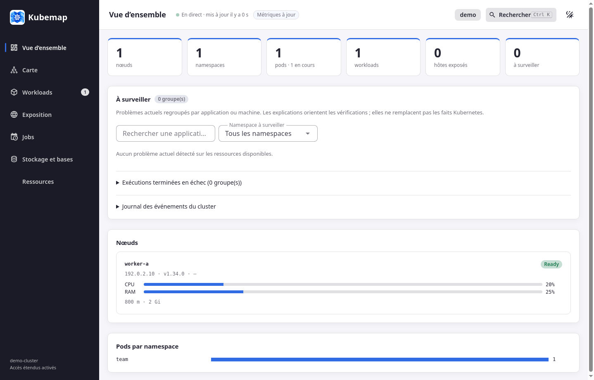
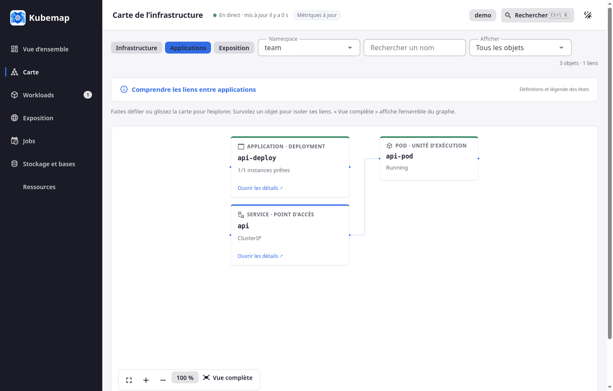

# Kubemap

A local Kubernetes map and troubleshooting dashboard. Explore infrastructure, applications, exposure, incidents, logs and storage from a single interface. Runs in your browser or as a Linux desktop application.

Kubemap is an early preview. The interface is currently in French. Collection is **read-only by default**; operational capabilities are separate opt-in launch options. One local server can serve independent browser-tab sessions.





## Quick start

Requirements: Python 3.11+, [uv](https://docs.astral.sh/uv/), Node.js 22+, npm and network access to your Kubernetes cluster. Install dependencies from the lockfiles:

```bash
uv sync --locked --group dev
npm ci --prefix web
npm run build --prefix web
uv run python -m kubemap
```

Open <http://127.0.0.1:8765>, choose **Charger un kubeconfig**, select a file and context, then connect. Kubemap never reads `~/.kube/config` or `KUBECONFIG` automatically. A VPN may be required to reach your cluster.

An explicit startup file is also supported:

```bash
uv run python -m kubemap --kubeconfig /path/to/config --context my-context
```

Browser imports accept YAML or JSON up to 1 MB, with a token or embedded client certificates/key. They reject local file paths, authentication plugins, proxies and disabled TLS verification. To produce a self-contained kubeconfig locally:

```bash
kubectl config view --raw --flatten > standalone-kubeconfig.yaml
```

That file contains credentials: keep it private and never add it to this repository. Credentials stay in server memory and are not saved to browser storage. Contexts from the last imported file can be selected again during the session. Each browser tab has an independent connection. Reloading a page creates a new session; idle sessions are reclaimed. `--kubeconfig` supplies the initial configuration for new tabs.

## What you can inspect

- **Overview:** active incidents grouped by Kubernetes owner, explanations, evidence, related events, node health and load.
- **Maps:** infrastructure, application ownership and exposure relationships. EndpointSlices provide service-to-pod links; these do not measure network traffic. Filtering, grouped/expanded namespaces, keyboard navigation and fullscreen are available.
- **Workloads:** pods, Deployments, StatefulSets and DaemonSets, with namespace/search/problem filters and controller-based grouping.
- **Exposure:** Ingress and optional Traefik routes, services, external endpoints, authentication middleware and certificate state.
- **Jobs:** active/recent/failed Jobs, CronJobs and upcoming schedules.
- **Storage:** requested PVC capacity and references, optional CloudNativePG status and secret metadata. Requested capacity is not actual disk usage; an unreferenced secret is not necessarily unused.
- **Resources:** ConfigMap metadata, HPA and NetworkPolicies, plus a discovered catalogue of built-in and custom resource types. Catalogue results contain metadata only and load on demand in pages of 500; search covers loaded pages.
- **Details:** resource requests/limits, probes, conditions, events, related objects, and JSON with known sensitive container fields redacted. Logs support application/init/ephemeral containers, following and the previous terminated instance.

The latest 200 events still retained by Kubernetes are shown; this is not a permanent incident history. Metrics are timestamped independently, cleared after collection failures and flagged as stale after 90 seconds. A lost connection keeps the last snapshot visible with a warning and automatically resynchronizes. Unavailable API types and insufficient permissions are reported.

Traefik, Flux, cert-manager and CloudNativePG are optional. No database connection or SQL query is made. Layers can be configured with `--layers /path/to/layers.yaml`; defaults contain no organization-specific namespaces. Global search uses `/` or `Ctrl+K`/`Cmd+K`; light and dark themes are available.

## Optional operations

All of the following are disabled by default and still require the relevant Kubernetes RBAC permissions:

| Option | Capability |
| --- | --- |
| `--allow-write` | Restart Deployments/StatefulSets/DaemonSets, scale Deployments/StatefulSets, suspend/resume CronJobs. |
| `--allow-portforward` | Open a localhost TCP tunnel to a Running pod. |
| `--allow-exec` | Open an interactive `bash` in a running container. |
| `--allow-secrets` | Reveal one named secret after confirmation. |
| `--allow-exec-auth` | Run authentication plugins from the explicitly chosen **local** `--kubeconfig`. |

```bash
uv run python -m kubemap --allow-write --allow-portforward
```

Management confirmations identify the context and object. The server checks the connection generation, object UID and resourceVersion before applying a version-guarded patch. Scaling to zero stops all instances. Flux/Helm markers require a separate acknowledgement because reconciliation may undo a local change. An accepted request is not proof that a rollout has completed.

Tunnels bind only to `127.0.0.1` on an automatically chosen port. They close when details close, the context changes or after 30 minutes; limits are five per session and sixteen connections per tunnel. Kubernetes checks `pods/portforward` permission at the first local connection. The cluster/network path must support Kubernetes WebSocket port forwarding. Other processes/users on the computer may access the local port.

Authentication plugins run without a shell or standard input, with a 30-second timeout. ExecCredential v1/v1beta1 tokens/certificates, expiry and renewal after HTTP 401 are supported; `interactiveMode: Always` and legacy `auth-provider` blocks are refused. Only use `--allow-exec-auth` with a trusted local file: its commands execute with your user permissions. Browser imports remain unable to execute plugins.

## Linux desktop

The desktop uses the same interface with pywebview, PySide6 and Qt/Chromium. It chooses a free localhost port by default and shuts down the server and connections when the window closes.

```bash
uv sync --locked --group desktop
npm ci --prefix web
npm run build --prefix web
uv run --group desktop python -m kubemap --desktop
```

On Ubuntu/Debian, the required system libraries can be installed with:

```bash
sudo apt install libgl1 libegl1 libxkbcommon0 libdbus-1-3 libnss3 libasound2t64 libxcomposite1 libxdamage1 libxrandr2 libxtst6 libxcb-cursor0 libxcb-icccm4 libxcb-image0 libxcb-keysyms1 libxcb-render-util0 libxcb-xinerama0 libxcb-xkb1 libxkbcommon-x11-0
```

Use `libasound2` instead of `libasound2t64` on Debian 12/Ubuntu 22.04. Run graphical tests in a real desktop session.

## Build a Debian package

Requirements: Linux, `dpkg-deb`, Node.js/npm and uv. The build creates a self-contained Python/Qt application without installing anything system-wide or contacting a cluster.

```bash
uv sync --locked --group desktop --group packaging
npm ci --prefix web
uv run --group desktop --group packaging python packaging/build_deb.py
```

The result is `dist/kubemap_0.1.0_<architecture>.deb`. Build on the oldest Linux distribution you intend to support, for each architecture. The package records the build machine's minimum glibc version and is not guaranteed to work on older distributions. Qt increases the package size.

```bash
sudo apt install ./dist/kubemap_0.1.0_amd64.deb
```

Launch **Kubemap** from the application menu. No background service or cluster connection is installed. Read [third-party licensing and redistribution notes](THIRD_PARTY_NOTICES.md) before distributing binaries. Publish the matching `kubemap_0.1.0_source.tar.gz` and preserve the dependency source references beside each binary release.

## Development and checks

```bash
uv sync --locked --group dev
uv run pytest -q
npm ci --prefix web
npm test --prefix web
npm run build --prefix web
```

For hot reload, run `uv run python -m kubemap` and `npm run dev --prefix web` in separate terminals. Vite proxies `/api` to backend port 8765.

The optional graphical smoke test uses a simulated cluster and opens a hidden Qt window:

```bash
uv run --group dev --group desktop python tests/desktop_smoke.py
```

It checks connection import, themes/fullscreen, diagnostic details, previous init-container logs, a local tunnel and a confirmed management request. No real cluster is used. To refresh the screenshots with fictional data, set `KUBEMAP_SCREENSHOT_DIR=docs/images` when running it.

See [CONTRIBUTING.md](CONTRIBUTING.md) for changes and pull requests, and [SECURITY.md](SECURITY.md) for private vulnerability reports.

## Security and limits

Kubemap listens on localhost and has no multi-user authentication. Do not expose it through a proxy or public tunnel. Use a dedicated Kubernetes identity with only the permissions you need. Collection uses a transport that rejects mutations and dangerous subresources; optional operations use separate connections.

Secret and ConfigMap collection requests metadata only. Environment values, container commands/arguments and HTTP probe headers are redacted. Logs, events, annotations and custom fields may still contain sensitive information. Log requests are capped at 2,000 lines and 1 MB outside follow mode; the browser retains up to 400,000 characters while following.

## License

Kubemap source and artwork are [MIT licensed](LICENSE). Dependencies retain their own licenses; desktop notices are collected in `/usr/share/doc/kubemap/third-party/`. Screenshots use only the fictional test cluster.
